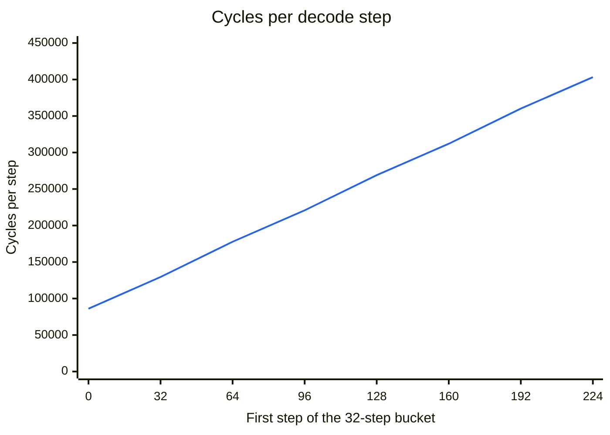

# Stories on the chip

Generated by `make lm` in `tb/accel/` (`tb/accel/lm_report.py`); do not edit by hand.

The frozen story model ran on `rtl/accel.v` for 256 steps from one `start` pulse: 8 stories decoded in parallel, one per B lane, the same prompt in every lane.
Every run's final memories are bit-exact against `compiler/golden.py`, and its token log and K/V caches are bit-exact against `model/lm_reference.py` (the ladder's levels 3 and 2).
The four runs: 2x2 at temperature 0 and 1.0, and 1x1 and 4x4 at 1.0.

## Results (2x2, temperature 1.0)

| Metric | Value |
|---|---:|
| Decode steps | 256 |
| Cycles | 62,677,232 |
| Cycles per step (8 tokens, one per story) | 244,833 |
| Cycles per token (per story) | 30,604 |
| OPERAND slot utilization | 31.5% |
| MAC utilization per tile | 7.9% |
| Cycles at temperature 0 (same mesh) | 62,157,860 |

## Stories (temperature 1.0)

Each story is one B lane's token log, decoded by `model/lm_tok.py`; a story ends at the next BOS, after which the lane starts a new one (not shown).
A story with no BOS stops where the run does, after its last step, often mid-word.
The prompt is the same in every lane; the per-lane seeds make the stories differ.

**Story 0** (ends at step 246)

> Once upon a time, there was a big stack of blankets in the forest. In the store, walked and walked, feeling very surprised. She wrapped all the new way to show the water. But them wasn't a huge angry pupcher, so he touched the sharks. But he suggested this hello to find another friend.
>
> One day, he heard a man heard a noise. He quickly, behind it, said to the bear? The clock manbean things! Bunboizy was so happy and enjoy his friends.
>
> The moral Jack was others, but sharing was that you have too late.

**Story 1**

> Once upon a time, there was a little girl named Lily. She had an incrediblates that she loved guessing her mom in the end. Lily loved to meet her furniture, even when it was too high.
>
> One sunny day, Lily went to the park to play with her friend, Timmy. They played together and had lots of fun without alays playing with the park. It was a big bear, but Lily did not see a big stwal ball with the red car. The stranger said, "gigors and have big as you ten from the hook when he helped with a smile!"
>
> Lily smiled and they played together all day. When she got to the park, she saw the pink ball falling. She was so happy to l

**Story 2**

> Once upon a time, there was a park where presents. It was a little as a horse, ask.
>
> One day, the park found an airplane in the park. It picked it up with its wings and covered it into its skills. It was a sleepy feeling, but it still asked it to improve. The friend said it asked to be more careful with them and his smelly fit.
>
> The parade worked and Whilke was a questinder. He ran back down the pill and hugged it tape that they needed to sit again. Now, he had a newtory and he was smiled. They knew that being a good little gir

**Story 3**

> Once upon a time, there was a frog. Fidary loved to play with his friends. They would go on an adventure together. The bird was organized, but it was not own any day.
>
> One day, a little boy came to help him. He said, "That sounds lively and can't be disgusting. I don't know how to love it. We will take a nail and some tape and your own salad's lip. And we might be safe for each. We can eat noise up in your waists to give it. Tweet did it's special and weak.
>
> The spoon made houses smaller things inside. It had b

**Story 4**

> Once upon a time, there was a little girl named Lily. She loved to play with her toy was the circle too. One day, she was too tired and dry imaginess of the sky. She searched for the sunst filling with paper and easier. She was sad because she needed to buy her oven.
>
> Lily's mom saw her and asked what if she could show her toy car to the circles. "I just snore, Lily!" said Lily with a smile.
>
> The fancy surprise to play with that she had her first." Her mom smiled and said it was a magical, and they all the first was turned around. From that day on, they would reser the puddles in p

**Story 5**

> Once upon a time, there was a cheerful drawer. Gragan liked to fly high in the sky and land one of them and not good about animals. One day the dragon was intrigued. It went to the blackboard. It flew inside and jared, and flowers as well. Next time, it kept it safe and show the flowers.
>
> She felt happy when she sneiled drawers, she would practice her mommy, and that she gave her a big hug. After explorations, Nemo's outside was a race, and the rabbit was acting too many races."
>
> She put all

**Story 6**

> Once upon a time, there was a little girl named Lily. She loved playing outside with her friends. One day, they were playing in the grandma's huge grandma swimming too hard. Every day, Lily went on a lose and could see her friend. Each opened the box, and they all every day. Every day, she would still spr through the grass, and Mr. Owl followed to a shop. Everyone had a great time and he drew tools.
>
> One day, the sky trip membered the comforth introds between the little toy and biggled the operation. Elfllny was so fast, he had never seen away so ri

**Story 7**

> Once upon a time, a little girl named Lily was sad. She wanted a beautiful dress, but she couldn't find her heart. Her name was Lily and her mommy. They both sat and play with the drum.
>
> Lily was so happy and could not see anyone while playing for each address his drum. She saw that Lily was perfect and she could sit. Sadly, her mommy coming lost and needed to go to the barn. Lily hugged her mommy and asked her in a jolly drum. Mrs. Bird said, "You have something else we should have be afraid. I will wear the necklace the bird."
>
> Her mommy agreed, but she laughed too mode

## Temperature 0

At temperature 0 the sampler is argmax and ignores the per-lane seeds, so with one prompt the 8 stories are identical by construction.
That run is a bit-exactness check (the token log equals the reference's), not 8 samples.
The one story (ends at step 221):

> Once upon a time, there was a little girl named Lily. She loved to play outside in the garden. One day, she found a big box in her room. She was so happy! She picked it up and showed it to her mom.
>
> "Look, Lily! There is a big box!" said Lily.
>
> "That's a great idea," said her mom. "It's always asking to make a big spoon."
>
> Lily was happy that she could help her mom. She went to the park to play with her friends. They played together and had lots of fun. From that day on, Lily always remembered to be careful and not to play with her friends.

## Where the cycles go (2x2, temperature 1.0)

Run cycles by category, from `rtl/cmd_perf.v` and `rtl/vpu_perf.v` (every category counted at node (0,0)'s injection port or at the VPU's busy line; the rows sum to 100%).
*Attention* is every cycle inside the program's attention loops (the QK^T and AV BLOCKs, their bookkeeping and the WAIT that drains them); *VPU* is the VPU's busy cycles; *weight matmuls* are the other cycles with a flit at the injection port or stalled; *other* is the rest (the command processor's ALU and loop commands, drains, credit stalls).

| Category | Cycles | Share |
|---|---:|---:|
| weight matmuls | 9,609,216 | 15.3% |
| attention | 37,290,032 | 59.5% |
| VPU | 15,108,284 | 24.1% |
| other | 669,700 | 1.1% |

VPU busy cycles by sub-op:

| Sub-op | Cycles | Share of run |
|---|---:|---:|
| EMBED | 39,168 | 0.1% |
| RMSNORM | 763,136 | 1.2% |
| ROPE | 532,480 | 0.8% |
| KVWRITE | 424,960 | 0.7% |
| SOFTMAX | 11,226,880 | 17.9% |
| SILU_MUL | 579,840 | 0.9% |
| ADD | 665,600 | 1.1% |
| TRANSPOSE | 97,280 | 0.2% |
| SAMPLE | 778,940 | 1.2% |

Cost by position (32-step buckets; attention grows with the context, the weight matmuls do not):

| Steps | Cycles per step | weight matmuls | attention | VPU | other |
|---|---:|---:|---:|---:|---:|
| 0-31 | 86,100 | 43.6% | 26.8% | 26.5% | 3.0% |
| 32-63 | 129,539 | 29.0% | 43.2% | 25.8% | 2.0% |
| 64-95 | 177,782 | 21.1% | 52.8% | 24.6% | 1.5% |
| 96-127 | 220,826 | 17.0% | 57.4% | 24.4% | 1.2% |
| 128-159 | 268,982 | 14.0% | 61.2% | 23.9% | 1.0% |
| 160-191 | 312,026 | 12.0% | 63.3% | 23.9% | 0.8% |
| 192-223 | 360,182 | 10.4% | 65.3% | 23.5% | 0.7% |
| 224-255 | 403,226 | 9.3% | 66.5% | 23.5% | 0.6% |

Cycles per step by position (mean over each bucket):

## Scaling (temperature 1.0)

| Mesh | Tiles | Cycles | Cycles per step | Cycles per token | Speedup vs 1x1 | MAC utilization per tile | Corner injection busy |
|---|---:|---:|---:|---:|---:|---:|---:|
| 1x1 | 1 | 76,958,144 | 300,618 | 37,577 | 1.00x | 25.6% | 32.1% |
| 2x2 | 4 | 62,677,232 | 244,833 | 30,604 | 1.23x | 7.9% | 34.5% |
| 4x4 | 16 | 61,943,056 | 241,965 | 30,246 | 1.24x | 2.0% | 34.1% |

## Model quality

Teacher-forced validation loss: float 1.240, int8 reference 1.303 (gap 0.06, gate 0.10).
For context, llama2.c's `stories260K` publishes 1.297; ours is not a like-for-like match (context 256 against 512, FFN width 192 against 172, our own training run), so it is an outside benchmark of the same kind, not a claim of equality.

The model, the quantization and the reference are `model/`; the machine-readable trace for the portfolio app is `docs/perf/lm_trace.json`.
